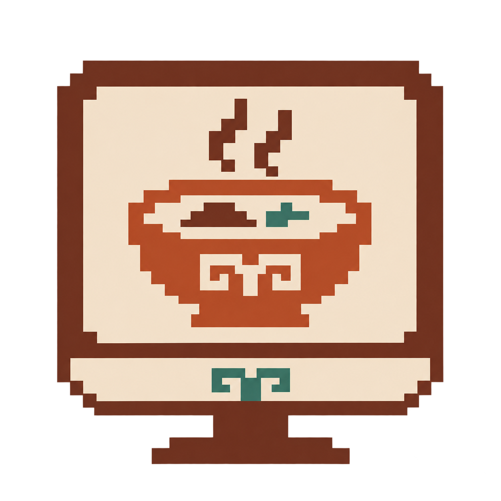
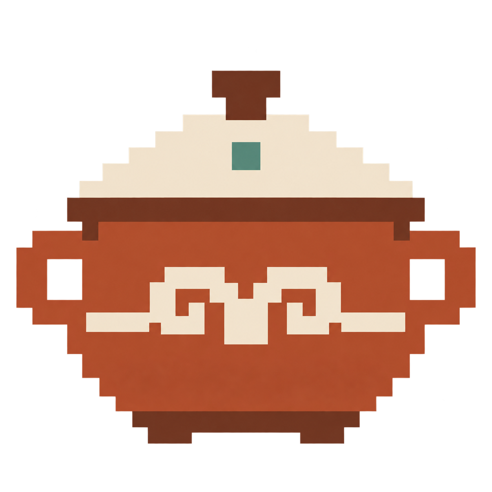
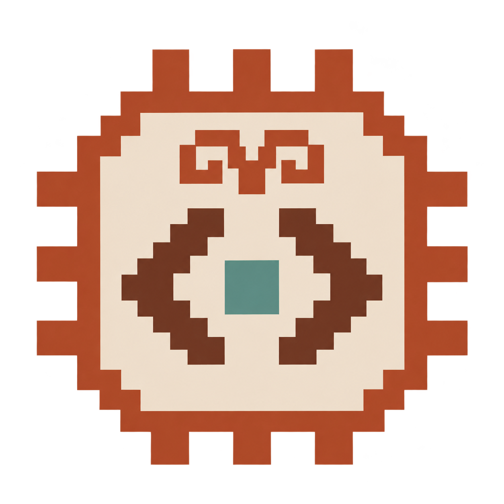
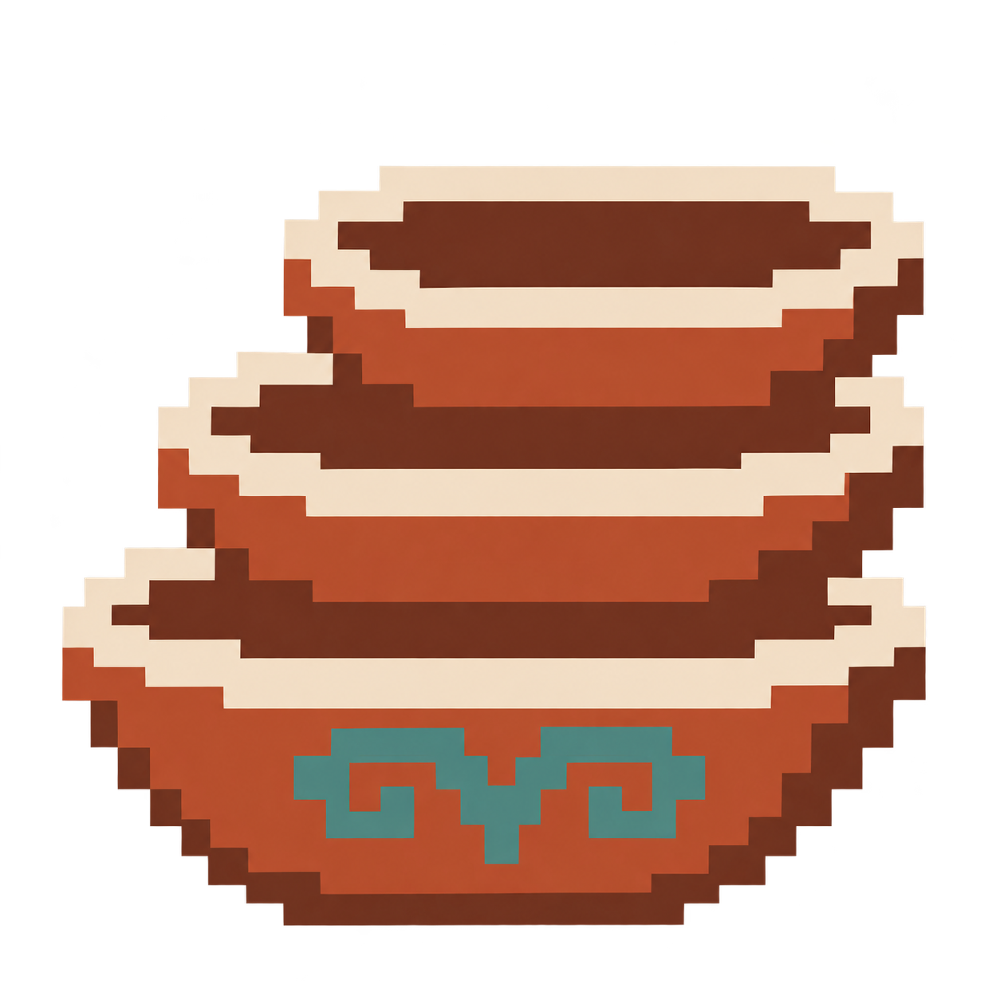
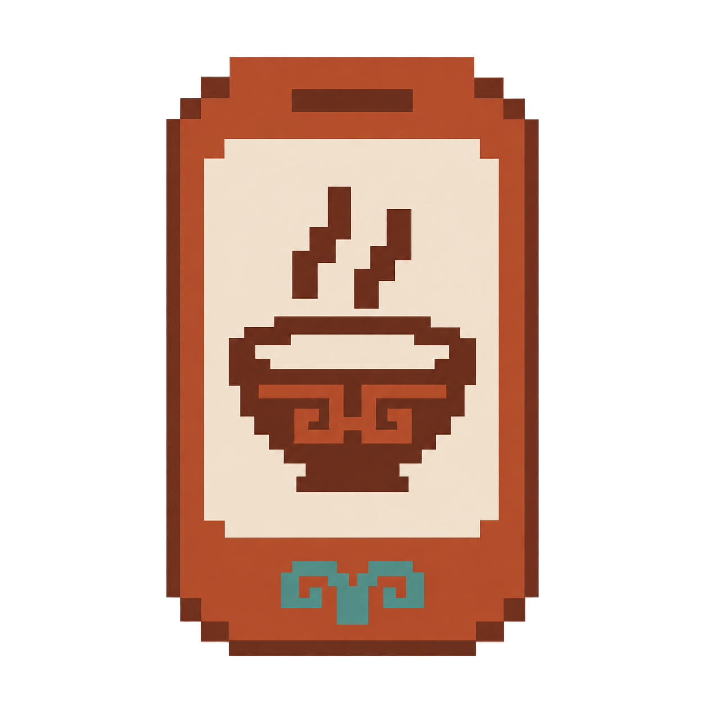
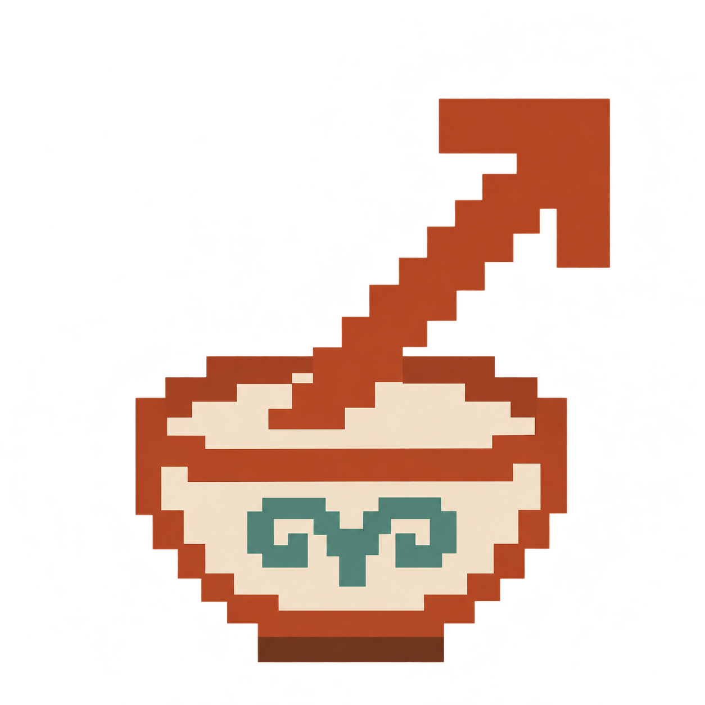
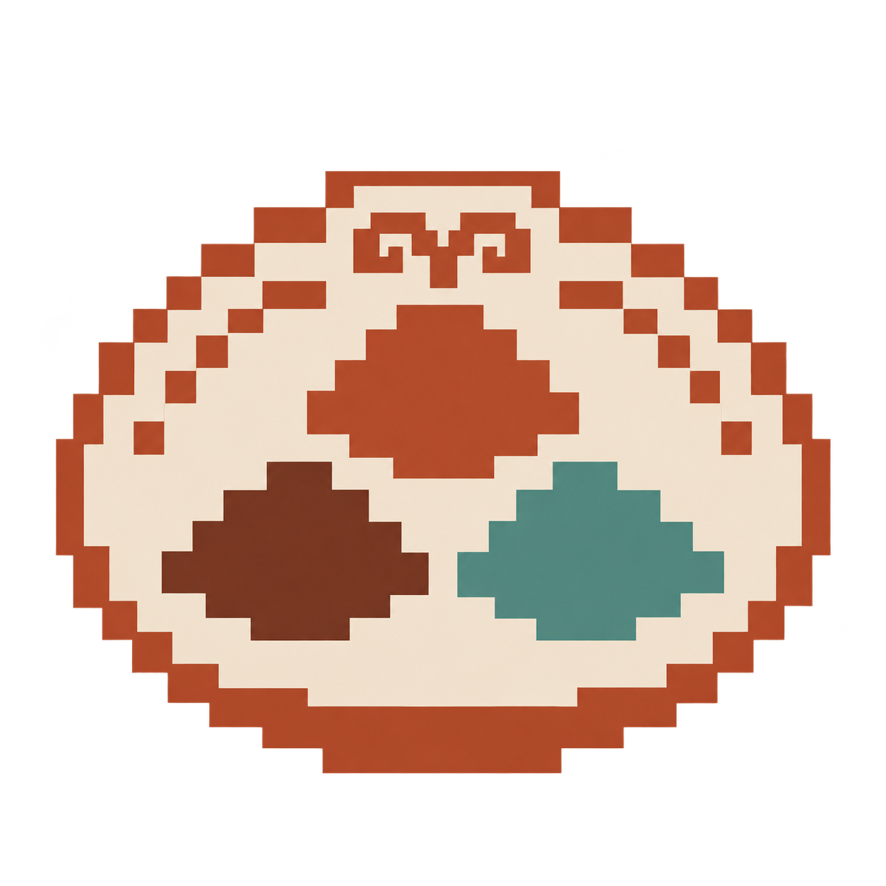
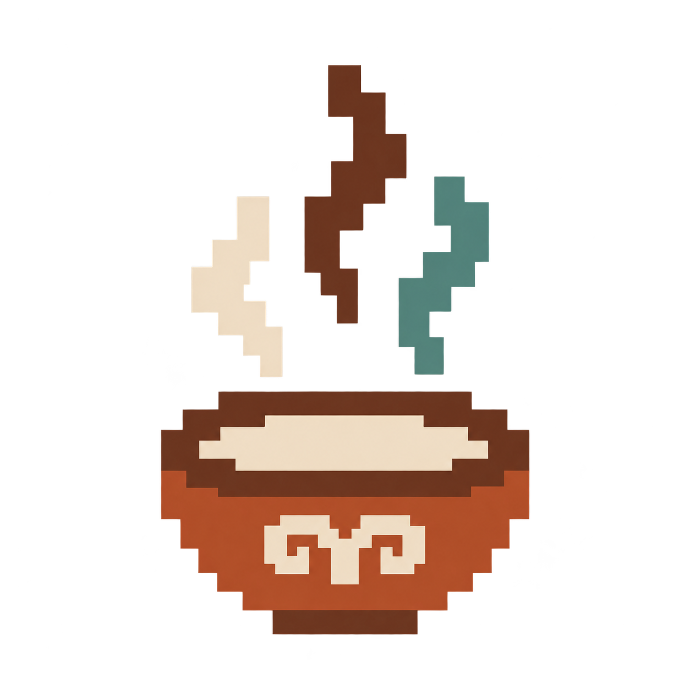

# Soup pixel icons

Twelve original icons for the repository README, generated individually with built-in imagegen. Transparent backgrounds, chunky pixel silhouettes, terracotta and cream with teal details, and Kazakh koshkar-muiz ornament connect them to Soup's existing piala, recipe and ladle family.

| Monitor | Quick start | Documentation | Charts |
| :---: | :---: | :---: | :---: |
|  |  |  |  |
| `soup-monitor.png` | `soup-start.png` | `soup-recipe.png` | `soup-chart.png` |

| Data pipeline | Verification | App code | Workspace layers |
| :---: | :---: | :---: | :---: |
|  |  |  |  |
| `soup-data.png` | `soup-check.png` | `soup-code.png` | `soup-layers.png` |

| Mobile | Open demo | Interface palette | Motion |
| :---: | :---: | :---: | :---: |
|  |  |  |  |
| `soup-phone.png` | `soup-open.png` | `soup-palette.png` | `soup-motion.png` |

Generated on 10 November 2026. All original rasters are preserved without bitmap editing. README display dimensions do not change source pixels. Full prompts and generation mode are saved in [prompts.json](prompts.json).
