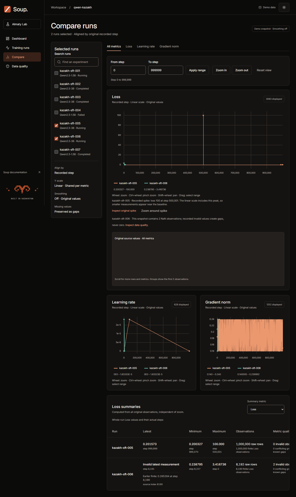

# Soup Training Monitor

Frontend delivery — 11 November 2026. [Production](https://soup-training-monitor.vercel.app) · [Repository](https://github.com/Feruum/SoupTask). Dashboard, Training runs, Run details, Compare and Data quality use 20 reproducible demonstration snapshots.

## Product and truthful data

The scenarios include nonfinite values, duplicates, conflicting values, unsorted steps, known gaps, zero, tiny metrics and a singleton. A Web Worker owns four immutable Float64 columns per run. Rendering preserves visible extrema and source row identity. The chart breaks at conflicts and known gaps, and the inspector shows original rows and their revision.

**Try it.** Open [R05](https://soup-training-monitor.vercel.app/runs/kazakh-sft-005), zoom around the peak and inspect source index `500001`. In this million-row run the unique Loss peak is `100` at step `500001`. Add two to four runs in [Compare](https://soup-training-monitor.vercel.app/compare) to check the actual step, all three metrics and Pin. Data quality links findings to their source rows. The dashboard map has a text alternative.

## Research applied to Soup

W&B and Comet informed the workflow from experiment overview to individual metrics. In a historical W&B issue, a maintainer reproduced points appearing and disappearing on refresh in a small plot and linked the effect to sampling. W&B later reported a full-fidelity mode. Soup tests the million-row spike against the original row and retains negative controls that deliberately drop or fabricate points. [W&B case](https://github.com/wandb/wandb/issues/4177) · [Comet experiment page](https://www.comet.com/docs/v2/guides/comet-ui/experiment-management/single-experiment-page/)

Grafana batches tooltip updates with microtasks and documents a stale chart-position cache that could turn a click into a drag after layout shifted. TradingView draws cursor changes on a separate canvas layer. Soup batches source table updates, keeps its geometry stable during hover and separates cursor drawing from the main plot. [Grafana source](https://github.com/grafana/grafana/blob/main/packages/grafana-ui/src/components/uPlot/plugins/TooltipPlugin2.tsx#L200-L299) · [TradingView source](https://github.com/tradingview/lightweight-charts/blob/master/src/gui/pane-widget.ts#L436-L482)

Chrome's guidance on layout helped explain why changing table text could trigger work on the whole page. Our traces identified a document-wide `body:has()` rule and repeated text node replacement. We switched to an explicit layout class and updated text in place. [Chrome layout guidance](https://web.dev/articles/avoid-large-complex-layouts-and-layout-thrashing) · [Full research and source notes](https://github.com/Feruum/SoupTask/blob/main/docs/research-complete-2026-11-10.md)

## Verification

Build, lint, **109 unit tests**, **131 Chromium tests** and all 20 regenerated manifest entries passed on snapshot `408d27b`. Tests cover actual Canvas pixels, raw values, stale responses, keyboard, touch, locale/timezone, both themes and DPR 2. The archive includes genuine failures. [Evidence manifest](https://github.com/Feruum/SoupTask/blob/main/reports/evidence-manifest.json)

Thirty axe audits found zero violations. Pixel checks resolved 484 contrast items requiring review. The original 516 are archived separately. Lighthouse scores were 95–97 for Performance and 100 for Accessibility and Best Practices.

<!-- pagebreak -->

## Performance and limits

All figures are **p95 in milliseconds** on the same app source. Windows 11, Ryzen 7, Chromium 158, 1440×900, DPR 1. CPU ×4 applies to the main renderer. Each run used five cold contexts and 30 samples per interaction scenario.

| Metric | Budget | Full trace 1 | Full trace 2 | No trace |
| --- | ---: | ---: | ---: | ---: |
| Cold render | 3,000 | 2,807.3 | **3,013.6** | 2,680.4 |
| Run zoom | 200 | 120.3 | 122.2 | 113.3 |
| Compare zoom | 200 | 161.0 | 142.3 | 126.8 |
| Run hover on entry | 50 | **64.5** | **52.8** | 37.5 |
| Compare hover on entry | 50 | **56.7** | **56.0** | 49.9 |
| Run continuous hover | 50 | 43.1 | 45.0 | 41.3 |
| Compare continuous hover | 50 | **50.9** | **50.8** | 49.8 |

Bold values exceed the budget. Hover starts at the pointer event and checks current values after two animation-frame callbacks. The test requires the text to fit the viewport and clipping bounds and samples occlusion at each cell center. This caught an earlier benchmark that accepted offscreen values. The results without recording met the budgets in one run. [Performance report and raw runs](https://github.com/Feruum/SoupTask/blob/main/docs/performance-results.md) · [Visible-value checks](https://github.com/Feruum/SoupTask/blob/main/reports/memory-investigation-2026-11-10/release-final-v2/visible-latency.json)

## Memory findings

A document mouseup listener retained a uPlot chart after an interrupted drag. Cleanup removes the listener and releases Canvas buffers. Baseline, active and return snapshots after 20 and 60 cycles found no new accumulation of detached nodes under those workloads. [Memory investigation](https://github.com/Feruum/SoupTask/blob/main/docs/memory-investigation.md)

| Windows renderer and Worker | Private committed (MiB) | Working set (MiB) |
| --- | ---: | ---: |
| Initial run | 149.4 | 247.3 |
| After 20 switches | 262.0 | 376.6 |
| Compare | 273.8 | 377.8 |

Process memory still grew after repeated navigation.

## AI assistance and handoff

The author designed the architecture and data pipeline, made the key engineering decisions and reviewed the code. AI helped implement and fix code, develop tests and independent oracles, run automated browser checks, and collect traces and measurements.
